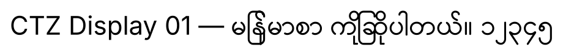
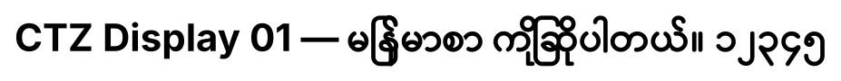
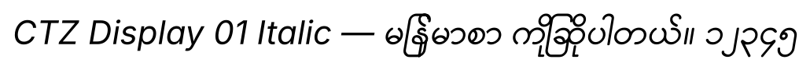
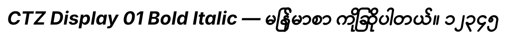

# CTZ Display 01

CTZ Display 01 is a bilingual Latin–Myanmar variable font combining Inter 4.001 with Pyidaungsu 2.5.3 Regular and Bold.

## Line-height and baseline fix

Version 0.4.1 fixes oversized text boxes and awkward icon/text centering in Figma, LibreOffice, and similar layout applications. Earlier builds inherited Pyidaungsu's very large vertical metrics (`2230/-1300`) and typographic line gap (`1663`), even when a text layer contained only Latin characters.

CTZ Display 01 now uses Inter's compact typographic line box (`1984/-494`, zero line gap) for consistent Latin baselines and UI alignment. Separate Windows clipping bounds remain large enough for tall and deep Myanmar forms, and the `USE_TYPO_METRICS` flag is enabled. Glyph outlines and Myanmar shaping positions were not vertically shifted.

## Problem solved

Inter is a strong variable UI font for English, but it does not contain a complete Myanmar glyph set or the shaping rules required for Burmese text. In Figma this can produce missing characters, inconsistent fallback fonts, incorrect stacked forms, or different line metrics between English and Myanmar.

Using Pyidaungsu separately fixes Myanmar rendering, but designers then have to switch fonts manually inside bilingual text. The first CTZ Display prototype combined both scripts in one family, but only Inter responded to the variable `wght` axis. Selecting Bold made the English text bold while Myanmar remained Regular.

CTZ Display 01 solves these problems in one font family:

- Latin text uses Inter and remains continuously variable.
- Myanmar text uses Pyidaungsu with its original Unicode mappings and `mym2` shaping behavior.
- Mixed English and Myanmar text can use one selected font in Figma.
- Selecting Bold activates the authentic Pyidaungsu Bold glyphs instead of leaving Myanmar Regular.
- Myanmar digits, medials, vowels, stacked forms, and contextual substitutions retain Pyidaungsu's shaping data.

## How the Bold fix works

Pyidaungsu Regular and Bold are separate static fonts. Their outline structures are not compatible enough to interpolate safely as conventional variable-font masters. Forcing interpolation would risk malformed glyphs and broken Myanmar shaping.

CTZ Display 01 therefore includes both complete Myanmar glyph sets. OpenType Feature Variations switch from Pyidaungsu Regular to Pyidaungsu Bold at weight 650. This produces a deliberate step between SemiBold and Bold while Inter continues to interpolate smoothly across the full weight range.

The italic font contains permanently slanted Myanmar outlines for both weight states. Myanmar marks and positioning anchors are transformed with the outlines, so the italic appearance comes from the font itself rather than Figma's synthetic italic styling. Because no hand-drawn Pyidaungsu italic master exists in the supplied sources, this is technically an oblique design.

## Download

- [Upright variable TTF](outputs/CTZDisplay01-Variable.ttf)
- [Italic variable TTF](outputs/CTZDisplay01-Italic-Variable.ttf)
- [Complete static TTF family](outputs/CTZDisplay01-Static-TTF.zip) — recommended for LibreOffice and software without variable-font support
- [Upright WOFF2](outputs/CTZDisplay01-Variable.woff2)
- [Italic WOFF2](outputs/CTZDisplay01-Italic-Variable.woff2)
- [Technical notes](outputs/README.md)

## Version 0.4.1 alignment fix

Version 0.4.1 gives the variable fonts a CTZ-specific PostScript variation prefix and restores Inter's GDEF Item Variation Store, preserving exact variable Latin kerning. Its typographic metrics remain identical to Inter, while safe Windows clipping bounds protect Myanmar marks and stacks.

Remove CTZ Display 01 v0.4.0 before installing v0.4.1, then fully restart Figma to clear the old family cache.

## Static font family

The static package contains 18 conventional TTF files:

| Upright | Italic |
|---|---|
| Thin | Thin Italic |
| ExtraLight | ExtraLight Italic |
| Light | Light Italic |
| Regular | Regular Italic |
| Medium | Medium Italic |
| SemiBold | SemiBold Italic |
| Bold | Bold Italic |
| ExtraBold | ExtraBold Italic |
| Black | Black Italic |

These files contain no variable-font tables. Each weight has explicit family, style, weight-class, bold, and italic metadata for traditional font menus in LibreOffice and similar applications. Myanmar uses the Regular design through SemiBold and the authentic Bold design from Bold through Black, matching the variable family.

## Variable behavior

- Inter varies continuously over `wght` 100–900 and `opsz` 14–32.
- Myanmar uses Pyidaungsu Regular at weights 100–600.
- Myanmar switches to the authentic Pyidaungsu Bold glyph set at weights 650–900.
- Myanmar shaping uses the original `mym2` GSUB/GPOS behavior from each Pyidaungsu master.
- The italic font includes slanted Myanmar outlines in both Regular and Bold states.

The Myanmar weight transition is discrete because the supplied Regular and Bold outlines are not interpolation-compatible.

## Known limitations

- Myanmar does not gradually interpolate between Regular and Bold.
- Weights 100–600 share the Pyidaungsu Regular design.
- Weights 650–900 share the Pyidaungsu Bold design.
- Myanmar italic is an engineered oblique transformation, not a separately hand-drawn italic design.
- Installations should still be checked with representative Burmese copy in the target Figma and operating-system environment.

## Specimens

### Regular

### Bold

### Italic

### Bold Italic

## Installation

Remove older CTZ Display builds before installing CTZ Display 01. Install either the two variable TTFs or the static family, not both at the same time, because their matching family/style identities can be reported as duplicates. Use the static package for LibreOffice. Restart affected applications after installation to clear cached font data.

## License

CTZ Display 01, Inter, and Pyidaungsu are distributed under the SIL Open Font License 1.1. See [LICENSE.txt](LICENSE.txt).
